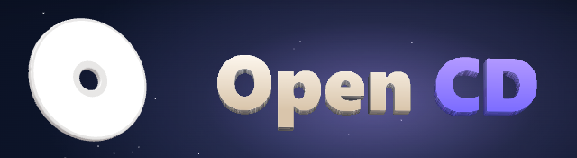
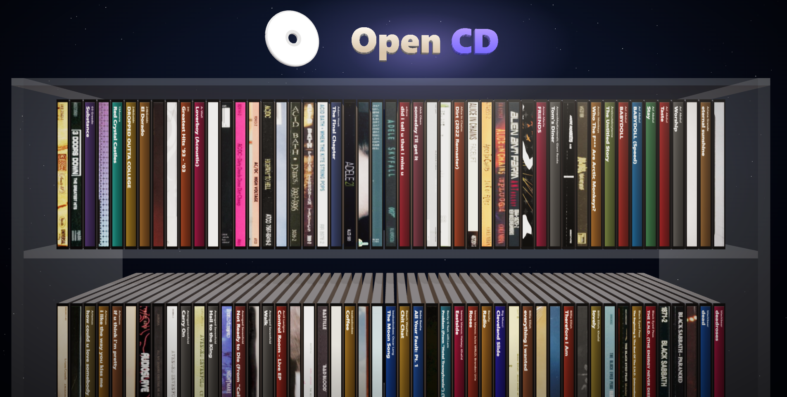

<p align="center">
  
</p>

Your local music library as a shelf of 3D CD cases. Hover a case to pull it out and see the front cover, click it to open the case, and the disc slides out and plays. Lyrics, an equalizer and a visualizer are built in.



## Download

Grab the latest build from the [Releases](https://github.com/txkex/Open-CD/releases) page:

- **Windows:** `OpenCD-<version>-portable.exe`. No install needed, just run it. The app is not code-signed, so Windows SmartScreen may warn you the first time: choose *More info*, then *Run anyway*.
- **Linux:** `OpenCD-<version>-x86_64.AppImage`. Make it executable (`chmod +x OpenCD-*.AppImage`) and run it. On Ubuntu 22.04 and newer you may also need `sudo apt install libfuse2` (`libfuse2t64` on 24.04).

macOS is not built right now.

## Using it

1. Click **Choose music folder** and pick the folder that holds your music. You can add more folders later in Settings.
2. Scroll the shelf, hover a case to see its cover, click to open it.
3. Press **Space** to play or pause, **←** / **→** for previous / next, **Esc** to close the case.

Supported audio: MP3, FLAC, M4A, AAC, OGG, Opus and WAV. Albums are grouped by folder, so wrong or inconsistent tags don't split an album apart. A `CD 1` / `Disc 2` subfolder is treated as part of its album.

### Artwork and lyrics

Cases use the artwork in your files. You can also drop images next to the music, and the file name decides what they are: `cover` / `folder` / `front`, `back`, `spine`, `tray`, `booklet` / `inlay`, `cd` / `disc` / `medium`, and `band` / `artist` / `photo`. Anything missing is looked up online or generated.

For lyrics, put a `.lrc` file with the same name next to a song. Otherwise the app can look lyrics up online.

## Privacy and network use

Open CD has no accounts and no telemetry. Your library, settings and caches stay in the app's data folder. The only network requests are optional lookups for artwork and lyrics, which can be switched off in Settings:

- Artwork: Cover Art Archive, MusicBrainz, iTunes Search and Wikipedia
- Lyrics: LRCLIB and lyrics.ovh

Album artwork and lyrics belong to their rights holders. This project doesn't ship any.

## Run from source

Needs [Node.js](https://nodejs.org) 18 or newer.

```sh
git clone https://github.com/txkex/Open-CD.git
cd Open-CD
npm install
npm start
```

`npm install` also copies the three.js browser build into `vendor/` (see `scripts/vendor.js`). On Windows you can use `run.bat` instead.

## Build the apps yourself

```sh
npm run dist          # Windows portable .exe
npm run dist:win      # Windows portable .exe and installer
npm run dist:linux    # Linux AppImage
```

Output goes to `dist/`. Windows builds are made on Windows and the AppImage on Linux.

### Publishing a release

Releases are built by GitHub Actions (`.github/workflows/release.yml`):

1. Change `version` in `package.json`, commit it.
2. Tag the commit with the same number and push the tag:
   ```sh
   git tag v0.3.1
   git push origin v0.3.1
   ```
3. The workflow builds the Windows and Linux apps and attaches both to a new GitHub release.

To use your own app icon, add a square `build/icon.png` (512×512 or larger) and rebuild. Without one, Electron's default icon is used.

## Built with

[Electron](https://www.electronjs.org), [three.js](https://threejs.org) (MIT) and [jsmediatags](https://github.com/aadsm/jsmediatags) (BSD-3-Clause).

## License

[MIT](LICENSE)
